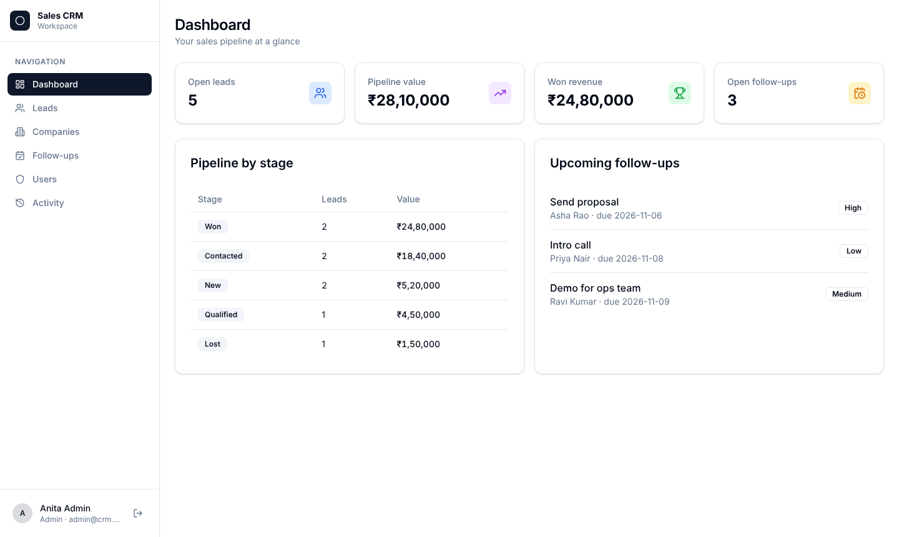
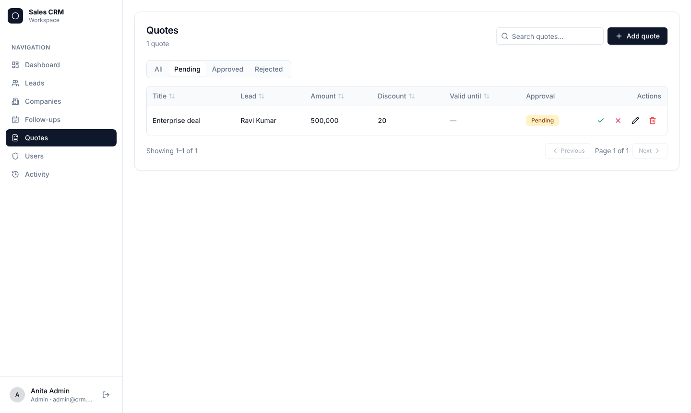
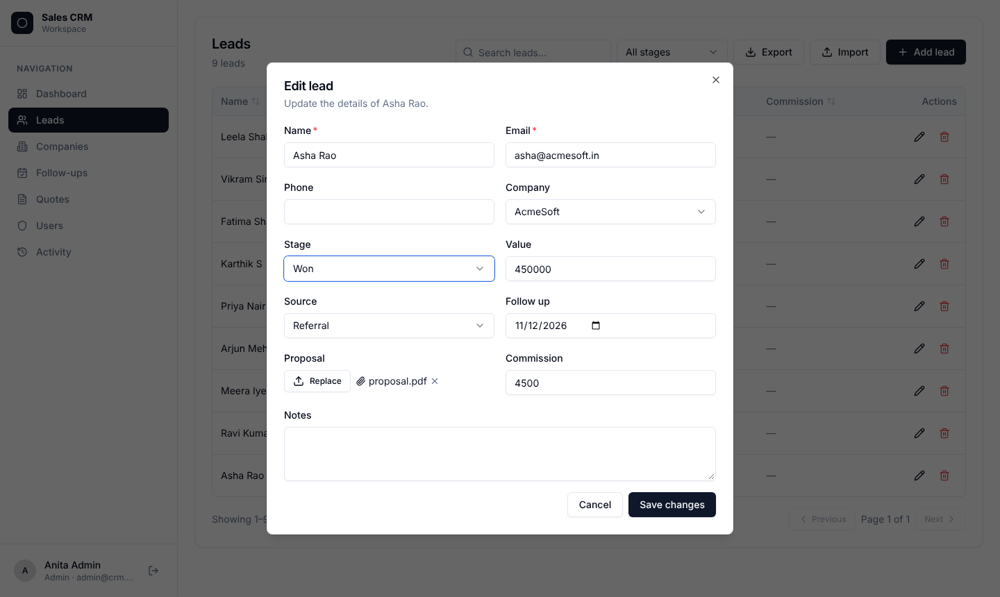
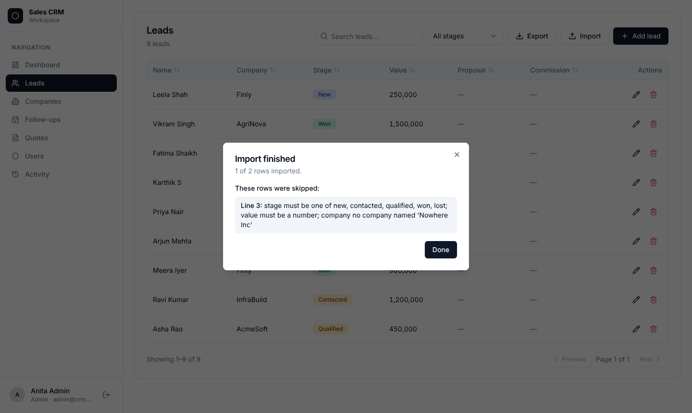
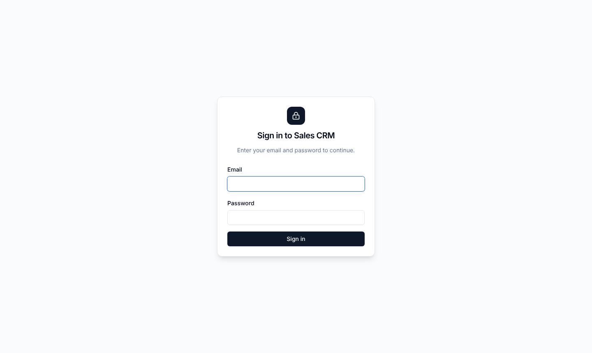
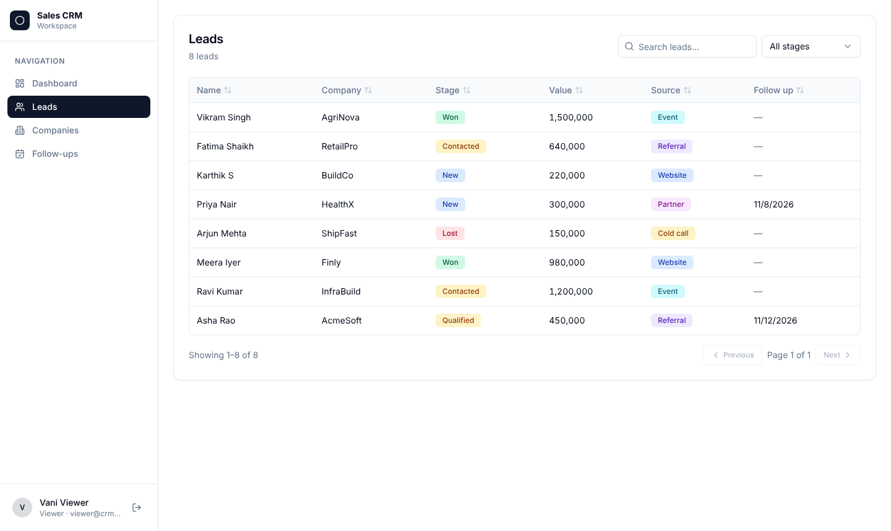
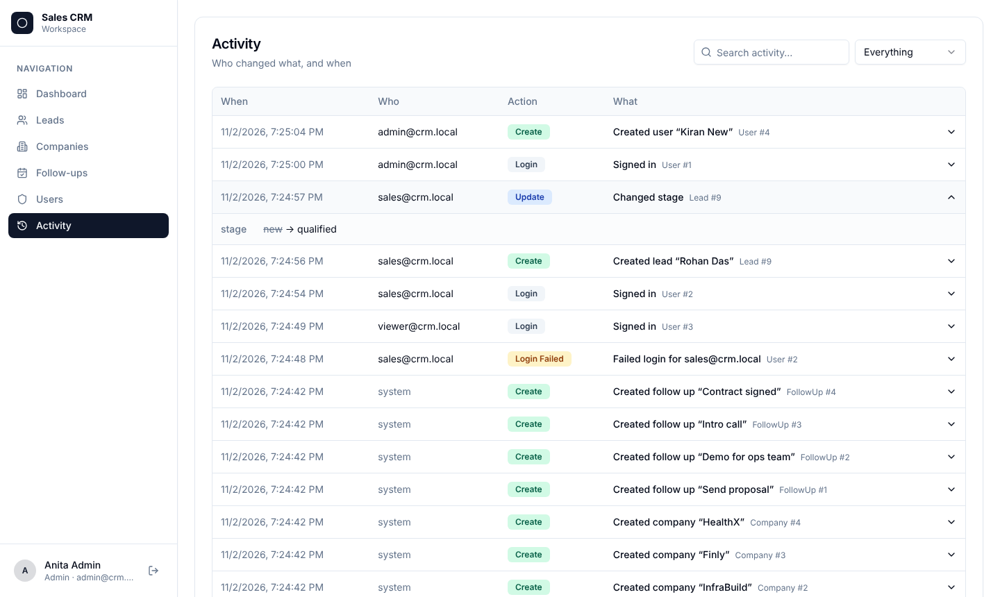
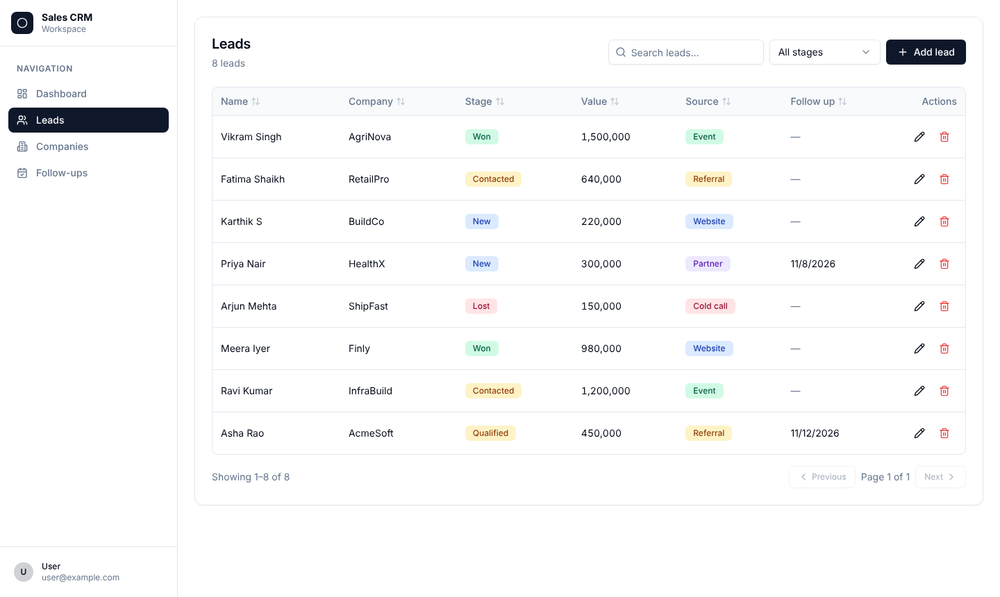
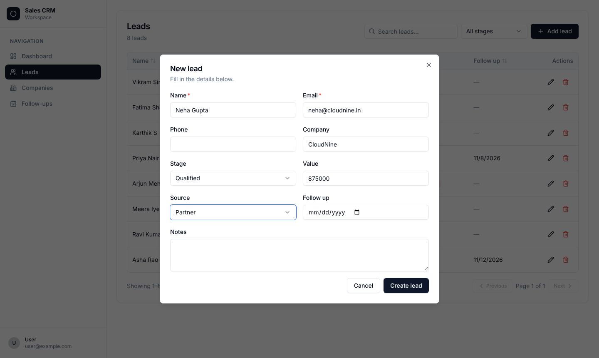

# Sales CRM — a full-stack MCN app

Leads, companies and follow-ups with search, filters, sorting, pagination,
create / edit / delete with validation, a live dashboard, **sign-in with
roles**, user management, an **activity log**, **quote approvals**, **automatic
emails with PDF quotes**, a **daily digest job**, **CSV import/export**, file
uploads, an admin-only field, optional **single sign-on**, and it installs on
phones as an app.
**About 300 lines of MCN in 4 files** (blank lines and comments included), with no hand-written React, SQL schema or API code.



| File | What it does |
|---|---|
| `models.mcn` | Roles and the data model (three `contract`s), shared by backend and UI |
| `backend.mcn` | `crud` with role rules and audit for each contract + a `get_dashboard` endpoint |
| `seed.mcn` | Demo accounts and sample data, inserted only when the database is empty |
| `app.mcn` | Dashboard, three `crud_table` screens, Users, Activity and the app shell |

## Run it

```bash
cd examples/crm_app
mcn serve --file backend.mcn --port 8080
```

In a second terminal:

```bash
cd examples/crm_app
mcn build app.mcn --out frontend
cd frontend
npm install
npx shadcn@latest add badge button card dialog input label select switch table textarea
npm run dev
```

Open the URL Vite prints (usually http://localhost:5173) and sign in with a demo account:

| Email | Password | Role | Can |
|---|---|---|---|
| `admin@crm.local` | `admin1234` | admin | everything, plus **Users** and **Activity** |
| `sales@crm.local` | `sales1234` | sales | add and edit leads, companies and follow-ups; delete follow-ups |
| `viewer@crm.local` | `viewer1234` | viewer | look, but not change anything |

The demo accounts come from `seed.mcn`. Delete those lines (and the database) to
start empty: the app then asks you to create the first administrator.
Set `MCN_SECRET` in production so sessions are signed with your own secret.

## How it works

A contract describes the data once (`ref` links it to other contracts):

```mcn
contract Lead
    name:   str
    email:  str unique
    stage:  choice("new", "contacted", "qualified", "won", "lost") = "new"
    value:  float = 0
    company: ref Company?              // dropdown of companies, name shown in tables
    notes:  text?
```

`crud Lead` in the backend creates the `leads` table and five endpoints:
`list_leads` (search, filters, sort, pages), `get_lead`, `create_lead`,
`update_lead` and `delete_lead`. Input is validated against the contract,
and errors come back per field.

`crud_table Lead` in the UI turns into a complete screen: table, search, a
stage filter, sortable columns, pagination, an add/edit form built from the
contract (dropdowns for choices, a toggle for booleans, a date picker for
dates), and a delete confirmation.

Add a field to a contract and restart. The column is added to the table and
appears in the form; existing data is kept.

### Workflows the CRM runs

| When | What happens (`backend.mcn`) |
|---|---|
| A lead's stage changes to **won** | The manager gets an email and a "Kick-off meeting" follow-up is created |
| A quote has more than **10% discount** | It waits for an admin to approve or reject it |
| A quote is **approved** | A PDF quote is generated and emailed to sales |
| A quote is **rejected** | Sales get an email with the reason |
| Every day at **09:00** | The manager gets a PDF of overdue follow-ups |

Emails are printed in the server console and kept in the outbox until you set `MCN_SMTP_HOST`
(see the main README). Leads also have a **proposal** upload and a **commission** field that only
admins can see, and the Leads and Companies screens have **Import** / **Export** (CSV).

| Quote approvals | Upload + admin-only field | CSV import report |
|---|---|---|
|  |  |  |

### Sign-in, roles and activity

```mcn
// models.mcn
auth
    roles admin, sales, viewer        // the first role is the administrator

// backend.mcn
crud Lead
    allow read:   admin, sales, viewer
    allow write:  admin, sales
    allow delete: admin
    audit                             // record every change

// app.mcn
nav "Users"    icon="shield"  component=Users     allow admin
nav "Activity" icon="history" component=Activity  allow admin
```

The server enforces the rules (401 when signed out, 403 for the wrong role), and
the UI hides what a role can't use. Users are a built-in `User` contract, so
`crud_table User` is the user-management screen, and `audit_log` is the
activity screen.

| Sign in | Viewer: read-only | Activity log |
|---|---|---|
|  |  |  |

| Leads | Form with validation |
|---|---|
|  |  |
